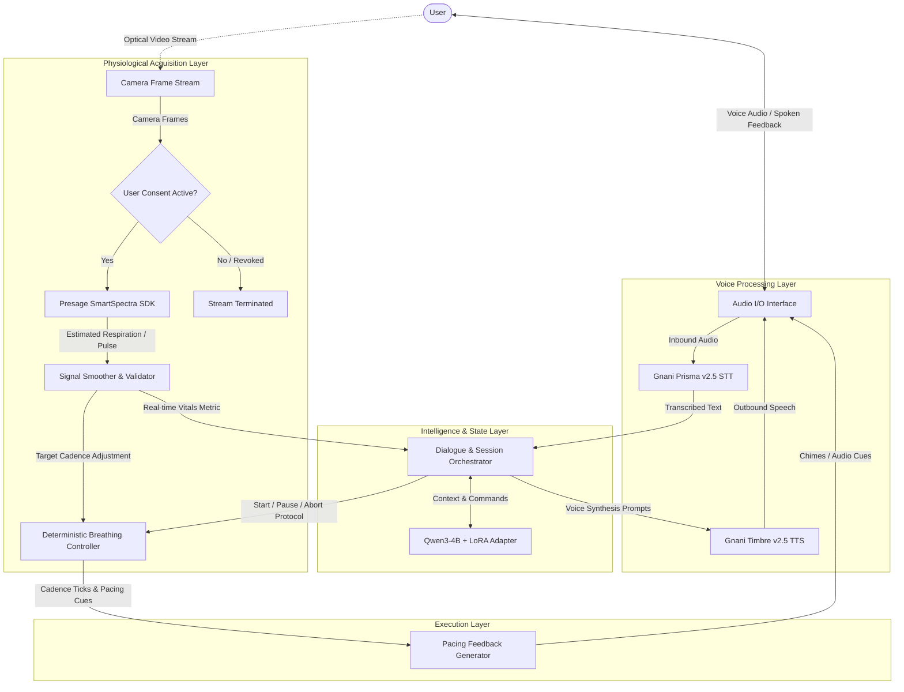
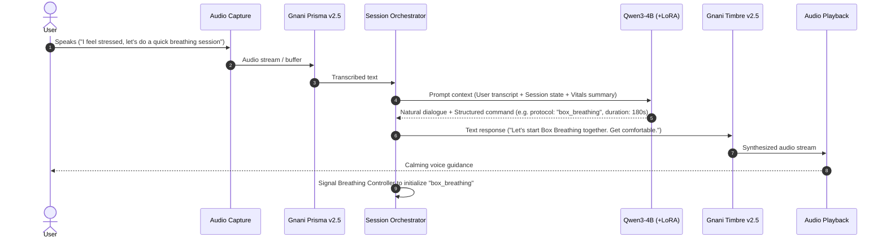
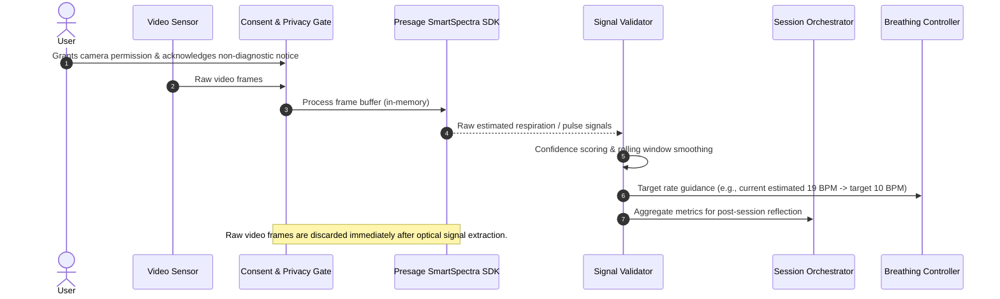

# BreatheFlow AI — System Architecture

## 1. Overview & Architectural Principles

**BreatheFlow AI** is an intelligent, voice-first adaptive breathing companion. It bridges conversational empathy, deterministic session pacing, and contact-free physiological estimation to support guided mindfulness and respiratory regulation.

### Core Architectural Principles
1. **Decoupled Determinism**: The conversational model (Qwen3-4B) provides natural language guidance and selects appropriate breathing protocols, but **never** drives the execution timing of breath cycles. Inhale/hold/exhale pacing is governed strictly by a deterministic clock.
2. **Voice-First Interaction**: Interaction is designed to be eyes-free and voice-driven using Gnani Prisma v2.5 for speech input and Gnani Timbre v2.5 for speech synthesis.
3. **Contact-Free Adaptive Feedback**: Real-time physiological signals estimated via the Presage SmartSpectra SDK dynamically adapt breathing targets without user manual entry.
4. **Ethical & Safety Guardrails**: Strict non-clinical boundaries. The system does not diagnose medical conditions, provide clinical advice, or claim to determine emotional state solely from camera feeds.

---

## 2. System Architecture & Component Responsibilities



### Component Details

| Component | Responsibility | Boundary / Constraints |
|---|---|---|
| **Gnani Prisma v2.5 (STT)** | Converts spoken user queries, comfort reports, and vocal commands into text. | Handles streaming audio or audio chunks; latency critical. |
| **Conversational Brain (Qwen3-4B + LoRA)** | Context understanding, empathetic conversation, breathing technique selection, and debriefing. | Does not execute real-time interval timers; outputs structured protocol instructions. |
| **Gnani Timbre v2.5 (TTS)** | Synthesizes warm, calm, rhythmic vocal guidance and breathing instructions. | Low-latency audio streaming for pacing feedback. |
| **Presage SmartSpectra SDK** | Extracts optical physiological estimates (respiration rate, pulse) from camera feed. | Runs only with explicit, active user consent; no persistent raw video storage. |
| **Deterministic Breathing Controller** | Controls precision millisecond timing for Inhale, Hold, Exhale, Hold phases. | Fully decoupled from model inference; unaffected by network or LLM latency jitter. |
| **Dialogue & Session Orchestrator** | Manages application state machine (Idle, Conversing, Preparing, In-Session, Paused, Debrief). | Mediates data flow between voice, physiological, and execution engines. |

---

## 3. Data & Interaction Flows

### 3.1 Voice Request / Response Flow
The voice loop enables eyes-free dialogue before, during, and after breathing sessions:



### 3.2 SmartSpectra Physiological Signal Flow
The camera stream provides real-time physiological estimates without intrusive data logging:



---

## 4. Qwen3-4B + LoRA Architecture

### Role and Model Boundary
Qwen3-4B acts as the **cognitive and empathetic companion**:
- **Technique Recommendation**: Maps reported feelings (anxiety, fatigue, focus needed) to verified respiratory patterns:
  - *Box Breathing (Sama Vritti)*: 4s Inhale, 4s Hold, 4s Exhale, 4s Hold (Stress reduction, focus).
  - *4-7-8 Breathing*: 4s Inhale, 7s Hold, 8s Exhale (Relaxation, sleep onset).
  - *Coherent Paced Breathing*: 5.5s Inhale, 5.5s Exhale (Resonance frequency at ~5.5-6 breaths/min).
  - *Physiological Sigh*: Two quick inhales, prolonged slow exhale (Acute panic / sigh reset).
- **Structured Tool / Protocol Output**: Generates structured JSON commands alongside conversational responses so the deterministic controller receives exact, type-safe session parameters.

### Fine-Tuning Specifications & Training Architecture (Milestones M0.2 & M2)
Detailed dataset analysis, curation strategy, and evaluation metrics are documented in [`docs/dataset-research.md`](file:///C:/Users/Aadesh/.gemini/antigravity/scratch/BreatheFlow-AI/docs/dataset-research.md).

- **Base Model (Confirmed)**: `Qwen/Qwen3-4B` (or `Qwen/Qwen2.5-3B-Instruct` pending exact release tag availability).
  - The base model weights remain **strictly untouched and frozen** in original precision.
- **Fine-Tuning Method (Confirmed)**: **Standard LoRA** (not QLoRA), preserving high precision representations without quantization degradation during training.
- **Framework (Confirmed)**: Hugging Face `transformers` + `peft` + `trl` (`SFTTrainer`).
- **Training Environment (Confirmed)**: Dedicated Cloud GPU (e.g. NVIDIA A10G / A100 / L4).
- **Artifact Management (Confirmed)**: The trained LoRA adapter weights and config are exported and stored separately from the base model, loaded dynamically at runtime.
- **LoRA Hyperparameters**:
  - Target Modules: `q_proj`, `k_proj`, `v_proj`, `o_proj`, `gate_proj`, `up_proj`, `down_proj`.
  - Rank ($r$): 16
  - Alpha ($\alpha$): 32
  - Dropout: 0.05
- **Dataset Strategy**:
  - Curated conversational dataset (**BreatheFlow-Core-SFT**, ~1,000 multi-turn dialogues).
  - Dual-output format: short, spoken conversational empathy ($\le 45$ words) + structured JSON `breathing_command` payload.
  - Multi-turn recovery flows (handling interruptions, dizziness, or requests to slow down).
  - Non-medical disclaimer reinforcement: model strictly declines clinical diagnoses and redirects users in distress.

---

## 5. Deterministic Breathing Session Controller & Contract

The controller is a standalone, deterministic state machine responsible for temporal precision during sessions:

```mermaid
stateDiagram-v2
    [*] --> Idle
    Idle --> Inhale: Start Session (Protocol Config)
    Inhale --> HoldIn: Inhale Time Elapsed
    HoldIn --> Exhale: Hold Time Elapsed
    Exhale --> HoldOut: Exhale Time Elapsed
    HoldOut --> Inhale: Cycles Remaining > 0
    HoldOut --> Completed: Cycles Reached
    Inhale --> Paused: User Pause / Voice Interruption
    Exhale --> Paused: User Pause / Voice Interruption
    HoldIn --> Paused: User Pause / Voice Interruption
    HoldOut --> Paused: User Pause / Voice Interruption
    Paused --> Inhale: Resume
    Paused --> Terminated: Abort / Cancel
    Completed --> [*]
    Terminated --> [*]
```



### 5.1 Strict Controller Contract & Safety Rules
1. **Ownership of Time**: The controller alone owns interval timing and phase state transitions. The conversational LLM **never** controls session timing or advances cycle phases.
2. **Deterministic Immutability Mid-Cycle**:
   - Inhale, hold, and exhale durations for an ongoing breath cycle are **locked** when the cycle begins.
   - Live physiological signals (e.g., from Presage SmartSpectra in M3) or noisy camera variations **must not** modify durations mid-phase or mid-cycle.
   - Any adaptive pacing adjustments (e.g., easing breathing rate down) are quantized and applied strictly at the start of a subsequent cycle.
3. **Data Contract**:
   ```python
   # Protocol Definition
   class BreathingPhase(Enum):
       IDLE = "idle"
       INHALE = "inhale"
       HOLD_IN = "hold_in"
       EXHALE = "exhale"
       HOLD_OUT = "hold_out"
       PAUSED = "paused"
       COMPLETED = "completed"
       TERMINATED = "terminated"

   @dataclass(frozen=True)
   class BreathingProtocol:
       name: str
       inhale_s: float
       hold_in_s: float
       exhale_s: float
       hold_out_s: float
       cycles: int

   @dataclass(frozen=True)
   class ControllerTick:
       phase: BreathingPhase
       elapsed_in_phase_s: float
       remaining_in_phase_s: float
       current_cycle: int
       total_cycles: int
   ```
4. **Interruption Safety**: The user can interrupt via voice or manual input at any millisecond. The controller immediately transitions to `PAUSED` or `TERMINATED` without waiting for the current breath phase to complete.

---

## 6. Minimal Practical M1 Engine Scaffold

To keep provider-specific API calls decoupled, testable, and maintainable, the minimal M1 implementation scaffold is organized as follows:

```
breatheflow/
├── __init__.py
├── config.py                 # Typed configuration loaded from environment variables
├── core/
│   ├── __init__.py
│   ├── controller.py         # Deterministic BreathingSessionController & protocol contracts
│   └── orchestrator.py       # Session state coordinator (STT -> Brain -> TTS -> Controller)
├── providers/
│   ├── __init__.py
│   ├── base.py               # Abstract Base Classes (STTProvider, TTSProvider, ConversationEngine)
│   ├── gnani_stt.py          # Gnani Prisma v2.5 REST adapter (X-API-Key-ID, multipart/form-data)
│   ├── gnani_tts.py          # Gnani Timbre v2.5 REST adapter (JSON payload, binary WAV stream)
│   └── ollama_brain.py       # Local Ollama Qwen3-4B adapter (prompted reasoning, no fine-tuning)
└── tests/
    ├── __init__.py
    ├── test_controller.py      # Unit tests for cycle transitions, timing precision, and pausing
    ├── test_gnani_adapters.py  # Mocked HTTP tests for Prisma STT & Timbre TTS adapters
    └── test_orchestrator.py    # Mocked end-to-end turn tests
```

### Provider Abstraction Contracts (`providers/base.py`)
```python
from abc import ABC, abstractmethod
from typing import BinaryIO, Dict, Any, Optional

class STTProvider(ABC):
    @abstractmethod
    def transcribe(self, audio_data: bytes, language_code: str = "en-IN") -> str:
        """Transcribe audio bytes to text."""
        pass

class TTSProvider(ABC):
    @abstractmethod
    def synthesize(self, text: str, voice: Optional[str] = None, speed: float = 1.0) -> bytes:
        """Synthesize text into WAV audio bytes."""
        pass

class ConversationEngine(ABC):
    @abstractmethod
    def generate_turn(self, user_text: str, session_context: Dict[str, Any]) -> Dict[str, Any]:
        """Generate empathetic spoken response and optional breathing command payload."""
        pass
```

---

## 7. Consent, Privacy, and Safety Boundaries

### 7.1 Non-Medical Disclaimer & Regulatory Boundaries
> [!IMPORTANT]
> **BreatheFlow AI is an educational, non-clinical wellness tool.**
> - It does **not** provide medical diagnoses, treatment advice, or clinical monitoring.
> - It does **not** claim to assess psychological disorders or determine emotional states solely from camera signals.
> - All physiological signals provided by the Presage SmartSpectra SDK are treated strictly as non-diagnostic wellness estimates to assist self-paced breathing exercises.
> - Users experiencing acute medical or psychological emergencies are explicitly directed to contact professional medical services.

### 7.2 Data Privacy & Retention Architecture
- **Camera Stream Privacy**:
  - Video frames captured for the Presage SmartSpectra SDK are processed **entirely in volatile memory**.
  - **Zero Frame Persistence**: Raw video frames are never written to disk, never serialized to databases, and never transmitted over external networks.
- **Audio Stream Privacy**:
  - Voice audio sent to Gnani Prisma v2.5 is transmitted strictly for transcription and discarded immediately following generation.
- **Explicit Consent Gating**:
  - Camera and microphone access require explicit, informed consent with an unambiguous explanation of signal estimation before any sensor is activated.
  - Users may revoke consent or toggle off camera sensing at any time, returning to voice-only guided breathing.

---

## 8. Technology Stack Evaluation

To ensure architectural clarity, the table below clearly demarcates confirmed choices from proposals under evaluation:

| Layer / Role | Technology Choice | Status | Rationale |
|---|---|---|---|
| **Speech-to-Text (STT)** | Gnani Prisma v2.5 | **Confirmed** | Mandatory challenge requirement (Gnani AI Challenge). |
| **Text-to-Speech (TTS)** | Gnani Timbre v2.5 | **Confirmed** | Mandatory challenge requirement (Gnani AI Challenge). |
| **Conversational Intelligence** | Qwen3-4B (Base prompt $\rightarrow$ Standard LoRA adapter) | **Confirmed** | Primary brain; untouched base model, separately versioned LoRA adapter. |
| **Model Fine-Tuning** | Standard LoRA (not QLoRA) via HF Transformers + PEFT | **Confirmed** | High-precision adapter training preserving base model weights. |
| **Training Environment** | Cloud GPU (e.g., A10G / A100) | **Confirmed** | High-throughput environment for Standard LoRA without local hardware bottlenecks. |
| **Physiological Sensing** | Presage SmartSpectra SDK | **Confirmed** | Mandatory challenge requirement (Presage SDK Challenge). |
| **Timing & Pacing Engine** | Deterministic Controller | **Confirmed** | Essential to prevent LLM latency jitter from breaking breath pacing. |
| **Backend Framework** | Python (FastAPI / Uvicorn) | *Proposed* | Best-in-class support for Hugging Face Transformers, PEFT, Python SDKs, and async WebSockets. |
| **Frontend / Client UI** | Web (React + Vite or Next.js) | *Proposed* | Seamless access to Web Audio API, WebRTC/Canvas camera capture, and cross-platform accessibility. |
| **LLM Serving / Inference** | Local Ollama (`qwen3:4b`) for M1 MVP $\rightarrow$ Cloud serving | **Confirmed (M1)** | Verified installed local Ollama `qwen3:4b` instance for zero-latency local MVP iteration. |

---

## 9. Open Architectural Questions

The following questions require verification during milestone preparation:

1. **Presage SmartSpectra SDK Integration Surface**:
   - Is the SmartSpectra SDK distributed as a client-side JavaScript/Wasm library, a native Python package, or a C++ shared library?
   - What are the minimum frame rate (FPS) and lighting constraints required for reliable optical signal extraction?
2. **Gnani Prisma & Timbre Protocols**:
   - Are Prisma v2.5 and Timbre v2.5 accessible via bi-directional WebSocket streaming or RESTful chunked endpoints?
   - What API authentication mechanisms and rate limits apply to the challenge developer credentials?
3. **Audio Pacing Latency**:
   - What is the round-trip latency of Timbre v2.5 for short spoken cues ("Inhale", "Exhale") versus utilizing pre-rendered audio chimes for deterministic phase ticks?
   - *Recommendation*: Use low-latency local audio chimes for cycle phase ticks (inhale/exhale start), and reserve Gnani Timbre TTS for rich conversational instructions and empathetic coaching.
