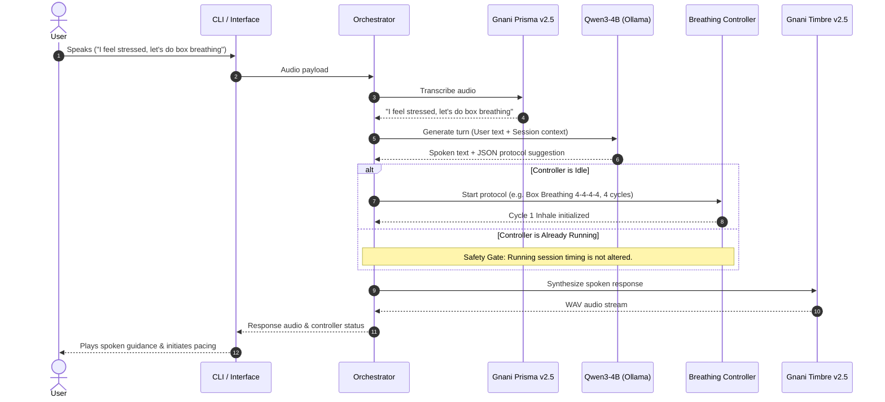

# BreatheFlow AI

> **A voice-first adaptive breathing and wellness companion designed to deliver natural conversational guidance, deterministic respiratory pacing, and contact-free physiological estimation.**

---

## Table of Contents

- [Overview](#overview)
- [The Problem](#the-problem)
- [Project Goals & Key Features](#project-goals--key-features)
- [Technology Stack Overview](#technology-stack-overview)
- [How Each Technology Is Used](#how-each-technology-is-used)
- [System Architecture](#system-architecture)
- [How a Session Works](#how-a-session-works)
- [Project Status](#project-status)
- [Engineering Roadmap](#engineering-roadmap)
- [Installation & Local Setup](#installation--local-setup)
- [Configuration](#configuration)
- [Running Tests](#running-tests)
- [Privacy, Consent & Safety](#privacy-consent--safety)
- [Future Work](#future-work)
- [Contributing](#contributing)
- [License](#license)

---

## Overview

**BreatheFlow AI** is an intelligent, voice-first breathing companion that bridges natural conversational empathy with mathematically deterministic respiratory pacing. 

Unlike traditional mindfulness applications that require users to stare at mobile screens, tap through menus, or listen to static pre-recorded audio tracks, BreatheFlow AI allows users to close their eyes and speak naturally. It interprets how the user is feeling, selects appropriate evidence-based breathing protocols, and guides the session with gentle, rhythmic voice prompts.

The product is architecturally designed around a core separation of concerns:
- **Conversational Brain (Qwen3-4B)**: Listens to the user, understands emotional context, provides empathetic reassurance, and suggests suitable breathing techniques.
- **Deterministic Session Controller**: A high-precision temporal state machine that strictly owns the millisecond timing of breath phases (Inhale, Hold, Exhale, Hold). This completely decouples breath pacing from network latency or language model generation delays.
- **Voice Pipeline (Gnani AI)**: Uses Gnani Prisma v2.5 for speech recognition and Gnani Timbre v2.5 for neural speech synthesis tailored for Indian English (`en-IN`).
- **Contact-Free Sensing (Presage SmartSpectra SDK)**: Planned optical physiological signal estimation using camera feeds to observe real-time breathing rates and gently adapt pacing without requiring wearable hardware.

---

## The Problem

Guided breathing exercises—such as Box Breathing, 4-7-8 Relaxing Breath, and Coherent Resonant Pacing—are proven practices for nervous system regulation, stress reduction, and mental centering. However, existing digital breathing tools suffer from fundamental usability and technical limitations:

1. **Screen Dependence & Eye Strain**: Most apps force users to look at expanding and contracting visual animations on a screen, which works against relaxation and sleep preparation.
2. **Rigid, Impersonal Automation**: Conventional apps offer static audio tracks that cannot adapt when a user feels dizzy, expresses anxiety before an exam, or needs to slow down.
3. **The LLM Timing Problem**: While conversational AI models can offer empathetic guidance, language models cannot be trusted to drive real-time timers. LLM token generation jitter, variable network latency, and hallucinations make direct model-driven pacing erratic and disorienting.
4. **Hardware Friction**: Wearable biometric sensors (smartwatches, chest straps) can be intrusive, expensive, or inconvenient to wear during brief daily pauses.

BreatheFlow AI addresses these challenges with a voice-first architecture that runs eyes-free, keeps timing execution deterministic and local, and plans non-invasive camera-based signal estimation.

---

## Project Goals & Key Features

| Capability | Description | Status |
|---|---|---|
| **Voice-First Interaction** | Eyes-free dialogue using Gnani Prisma v2.5 (STT) and Gnani Timbre v2.5 (TTS). Users speak and listen naturally. | **Implemented** (REST Adapters & Mock Harness) |
| **Conversational Reasoning** | Local Qwen3-4B model (`qwen3:4b` via Ollama) provides empathetic listening and suggests appropriate breathing protocols. | **Implemented** (Prompted Base Integration) |
| **Deterministic Controller** | High-precision timing engine for Inhale / Hold / Exhale cycles. Decoupled from LLM generation and network latency. | **Implemented** |
| **Command-Line Interface (CLI)** | Functional CLI runner supporting audio file input, WAV response generation, and an offline `--mock` execution mode. | **Implemented** |
| **Safe Error Handling** | Graceful degradation on empty speech, network timeouts, quota limits, and malformed responses without application crashes. | **Implemented** |
| **Offline Test Coverage** | Comprehensive unit test suite with 58 automated tests verifying timing, transitions, provider abstractions, and CLI error handling. | **Implemented** |
| **Standard LoRA Adaptation** | Specialized fine-tuning for Qwen3-4B using Hugging Face Transformers + PEFT for enhanced conversational cadence and protocol generation. | **Planned** (Milestone M2) |
| **Physiological Signal Feedback** | Contact-free estimation of breathing rate and pulse via Presage SmartSpectra SDK to adapt target tempos. | **Planned** (Milestone M3) |
| **Web User Interface** | Accessible, browser-based voice interface with subtle visual pacing rings and privacy consent controls. | **Under Evaluation** |

---

## Technology Stack Overview

| Technology | Category / Role | Status |
|---|---|---|
| **Python (3.10+)** | Primary implementation language for core engine, controller, providers, and CLI | **Implemented** |
| **Gnani Prisma v2.5** | Speech-to-Text (STT) REST API for Indian English speech recognition | **Implemented** (Adapter + Mocks) |
| **Gnani Timbre v2.5** | Text-to-Speech (TTS) REST API for natural speech synthesis (`Kaveri` voice persona) | **Implemented** (Adapter + Mocks) |
| **Ollama** | Local LLM runtime hosting and serving the conversational model | **Implemented** (Local Integration) |
| **Qwen3-4B (`qwen3:4b`)** | Conversational brain for dialogue, emotional listening, and technique selection | **Implemented** (Prompted Base) |
| **Deterministic Controller** | Internal state machine owning interval timing and phase transitions | **Implemented** |
| **Python `unittest`** | Automated offline testing suite verifying contracts, timing, and error handling | **Implemented** (58 Tests) |
| **Standard LoRA (PEFT)** | Parameter-Efficient Fine-Tuning method for Qwen3-4B conversational specialization | **Planned** (M2) |
| **Hugging Face Transformers / TRL** | Training pipeline and dataset processing for conversational model adaptation | **Planned** (M2) |
| **Presage SmartSpectra SDK** | Optical physiological signal acquisition (contact-free respiration and pulse) | **Planned** (M3) |
| **FastAPI / Uvicorn** | Proposed asynchronous backend service layer for web client communication | **Under Evaluation** |
| **React + Vite / Next.js** | Proposed web client application providing accessible visual pacing and audio streaming | **Under Evaluation** |
| **Git & GitHub** | Source code management, milestone tracking, and open documentation | **Active** |

---

## How Each Technology Is Used

- **Python (3.10+)**: Forms the core foundation of BreatheFlow AI. The controller, provider adapters, session orchestrator, and test suite are implemented cleanly using Python standard libraries (`urllib`, `dataclasses`, `enum`, `json`, `collections`, `unittest`, `argparse`), minimizing external dependency risk.
- **Ollama**: Runs locally on the host machine to serve `qwen3:4b` over an HTTP REST API (`http://localhost:11434/api/chat`). It enables zero-cloud-cost, low-latency local conversational inference during development.
- **Qwen3-4B (`qwen3:4b`)**: Serves as the cognitive companion. It interprets user speech, extracts intent (e.g., pre-exam jitters, bedtime relaxation), provides concise spoken reassurance ($\le 40$ words), and emits structured JSON recommendations. Crucially, **it does not execute timers**.
- **Gnani Prisma v2.5**: Converts recorded user speech into clean text. It accepts binary audio through multipart/form-data requests to the Gnani Vachana platform, optimized for Indian regional accents and telephony-grade audio.
- **Gnani Timbre v2.5**: Synthesizes spoken responses into natural audio WAV streams. Configured with calming voice personas (such as `"Kaveri"`) and pacing modifiers (`speed=0.95`) to ensure vocal output is soothing and clear.
- **Deterministic Breathing Controller**: An isolated state machine (`DeterministicBreathingController`) that computes exact durations for `INHALE`, `HOLD_IN`, `EXHALE`, and `HOLD_OUT`. It is driven by explicit delta-time steps, ensuring breath timing remains mathematically exact even if network calls or LLM responses take several seconds.
- **Presage SmartSpectra SDK (Planned)**: Will capture optical video frames from the user's camera in memory, extract contact-free physiological metrics (such as instantaneous breathing rate), and provide non-diagnostic guidance to help the orchestrator ease the user toward calmer breathing.
- **Hugging Face Transformers, PEFT & TRL (Planned)**: Will execute the Standard LoRA fine-tuning workflow on a cloud GPU. The base `Qwen3-4B` model remains frozen, and lightweight adapter weights are trained to optimize voice-first dialogue conciseness and protocol formatting.
- **FastAPI / Uvicorn (Proposed)**: Proposed backend framework to expose WebSocket endpoints for full-duplex voice streaming when transitioning from the CLI to a browser client.
- **React + Vite / Next.js (Proposed)**: Proposed front-end interface to deliver cross-platform browser accessibility, Web Audio API playback, and explicit camera consent toggles.
- **Python `unittest`**: Powers the offline test suite. Uses standard library mocks (`unittest.mock`) to verify controller state transitions, HTTP error parsing, API secret masking, and CLI behavior without requiring live network access or consuming API quotas.

---

## System Architecture

```mermaid
graph TD
    User([User]) <--> |Spoken Voice / Audio Cues| AudioIO[Audio I/O / CLI]
    User -.-> |Optical Camera Stream (Consent-Gated)| CameraIO[Video Sensor Stream]

    subgraph "Voice Processing Layer"
        AudioIO -->|Inbound Speech WAV| PrismaSTT[Gnani Prisma v2.5 STT]
        TimbreTTS[Gnani Timbre v2.5 TTS] -->|Outbound Speech WAV| AudioIO
    end

    subgraph "Orchestration & Intelligence Layer"
        PrismaSTT -->|Transcript| Orchestrator[BreatheFlow Orchestrator]
        Orchestrator <-->|Prompt Context & Turn Generation| OllamaQwen[Local Ollama / Qwen3-4B]
        Orchestrator -->|Spoken Guidance Text| TimbreTTS
    end

    subgraph "Execution Layer"
        Orchestrator -->|Initialize Protocol (If Idle)| Controller[Deterministic Breathing Controller]
        Controller -->|Phase State / Tick Remaining| Orchestrator
        Controller -.->|Deterministic Pacing Ticks| AudioIO
    end

    subgraph "Physiological Sensing Layer (Planned - M3)"
        CameraIO -->|Volatile Frames| SmartSpectra[Presage SmartSpectra SDK]
        SmartSpectra -->|Estimated Respiration Rate| Orchestrator
    end
```

### Architectural Separation
1. **Model Independence**: The LLM output is purely advisory. When the controller is already running a session, any incoming LLM recommendations are safely ignored to prevent breaking an active breathing rhythm.
2. **Volatile Biometrics**: Camera frames are processed strictly in volatile memory by the SmartSpectra SDK. No raw video frames are written to disk or transmitted across networks.

---

## How a Session Works



1. **Voice Input**: The user speaks into the microphone (or provides an audio file).
2. **Transcription**: Gnani Prisma v2.5 converts the spoken audio into text. If the transcript is empty, the orchestrator immediately generates a localized repetition prompt without invoking the LLM.
3. **Conversational Reasoning**: The transcript and non-diagnostic session context (current phase, cycle count) are passed to Qwen3-4B via Ollama.
4. **Protocol Selection**: If the user requested an exercise and the controller is idle, the orchestrator parses the validated JSON protocol and initializes the controller.
5. **Voice Synthesis**: Gnani Timbre v2.5 synthesizes the spoken guidance using the designated voice persona (`Kaveri`).
6. **Deterministic Pacing**: The breathing controller executes precision Inhale, Hold, Exhale intervals.

---

## Project Status

The project is currently at **Milestone M1.3 Complete / M1.4 Pending**.

- [x] **M0.1 — Foundation & Specifications**: Architecture definition, engineering roadmap, and safety boundaries.
- [x] **M0.2 — Dataset Research & Training Design**: Evaluation of public mindfulness corpora, non-medical safety gates, and SFT dataset schema.
- [x] **M1.1 — Core Scaffold & Controller**: Typed configuration, provider abstract base classes, and the deterministic breathing controller with fractional step timing.
- [x] **M1.2 — Provider Adapters**: REST clients for Gnani Prisma STT, Gnani Timbre TTS, and local Ollama Qwen3-4B integration.
- [x] **M1.3 — Dialogue & Session Orchestration**: End-to-end voice loop coordination, bounded session history, CLI runner, and HTTP 200 JSON error validation.
- [ ] **M1.4 — Gnani MVP Submission Package**: Real Gnani API smoke testing with challenge credentials, public demo video recording, and challenge submission post.

**Current Test Metrics**: **58 unit tests passing** (100% offline, deterministic execution in ~0.02s).

---

## Engineering Roadmap

BreatheFlow AI targets two primary milestones:
1. **Gnani AI Great Indian AI Internship Challenge** (Deadline: **November 10, 2026, 11:59 PM IST**)
2. **Presage SmartSpectra SDK Challenge** (Deadline: **November 22, 2026, 11:59 PM PST**)

| Milestone | Target | Focus | Deliverables |
|---|---|---|---|
| **M1** | Nov 10, 2026 | **Gnani Voice MVP** | Prisma STT, Timbre TTS, Prompted Qwen3-4B, Deterministic Controller, CLI runner, public demo video. |
| **M2** | Nov 15, 2026 | **Qwen3-4B LoRA Fine-Tuning** | Standard LoRA adapter trained on Cloud GPU using curated multi-turn mindfulness dataset. |
| **M3** | Nov 18, 2026 | **Presage SmartSpectra SDK** | Contact-free optical signal acquisition (respiration/pulse), consent gate, and cadence adaptation. |
| **M4** | Nov 22, 2026 | **Hardening & Presage Submission** | End-to-end testing, privacy disclosures, final demo video, and official DEV challenge submission post. |

For detailed checklists, risk matrices, and dependency analysis, see [`ROADMAP.md`](ROADMAP.md).

---

## Installation & Local Setup

### Prerequisites
- **Python 3.10+** (verified on Python 3.13)
- **Ollama** installed and running locally
- **Windows PowerShell** or standard POSIX terminal

### 1. Clone the Repository
```powershell
git clone https://github.com/aadesh-2006/BreatheFlow-AI.git
cd BreatheFlow-AI
```

### 2. Set Up Python Environment
BreatheFlow AI currently uses **Python standard library modules** for its core engine, CLI, and test suite. No external packages are strictly required to run offline tests or the CLI in `--mock` mode.

If you plan to install development tools, creating a virtual environment is recommended:
```powershell
py -m venv .venv
.\.venv\Scripts\Activate.ps1
```

### 3. Pull the Conversational Model
Ensure Ollama is running, then pull the `qwen3:4b` model:
```powershell
ollama pull qwen3:4b
```
Verify the model is listed:
```powershell
ollama list
```

### 4. Configure Environment Variables
Copy the sample environment template:
```powershell
Copy-Item .env.example .env
```
Open `.env` and configure your settings. For offline testing, default placeholders are sufficient. For live mode, provide a valid `GNANI_API_KEY`.

### 5. Run the CLI Runner

#### Offline Mock Mode (No API keys or Ollama required):
```powershell
py -m breatheflow.cli --mock
```
Output:
```text
==================================================
  BreatheFlow AI — Voice Companion CLI
==================================================
[Mode] Running with MOCK providers (offline test).
[Input] Using simulated input audio.

--- Processing Voice Turn ---
Status:             success
Recognized Speech:  "I am feeling anxious before my exam. Can we do box breathing?"
Assistant Response: "I hear you. Let's do Box Breathing together to steady your focus. Sit comfortably."
Breathing Protocol: box_breathing (Inhale: 4.0s, Hold: 4.0s, Exhale: 4.0s, Cycles: 4)
Controller State:   Phase: inhale, Cycle: 1/4, Phase Remaining: 4.0s
Audio Output:       Saved 52 bytes to output_response.wav
-----------------------------
```

#### Live Mode (Requires valid `GNANI_API_KEY` and Ollama):
```powershell
py -m breatheflow.cli --audio path/to/user_speech.wav --output response.wav
```

---

## Configuration

Configuration is managed via [`breatheflow/config.py`](breatheflow/config.py) and loaded from system environment variables or a local `.env` file.

| Variable | Description | Default |
|---|---|---|
| `GNANI_API_KEY` | Developer API key for Gnani Vachana platform | *None* |
| `GNANI_BASE_URL` | Base API gateway URL | `https://api.vachana.ai` |
| `GNANI_STT_MODEL` | Speech-to-Text model name | `prisma-v2.5` |
| `GNANI_STT_LANGUAGE_CODE` | Target STT language tag | `en-IN` |
| `GNANI_TTS_MODEL` | Text-to-Speech model name | `timbre-v2.5` |
| `GNANI_TTS_LANGUAGE_CODE` | Target TTS language tag | `en-IN` |
| `GNANI_TTS_VOICE` | Voice persona | `Kaveri` |
| `GNANI_TTS_SPEED` | Speaking pace modifier | `0.95` |
| `OLLAMA_HOST` | Ollama daemon endpoint URL | `http://localhost:11434` |
| `OLLAMA_MODEL` | Local conversational model tag | `qwen3:4b` |
| `LOG_LEVEL` | Application logging verbosity | `INFO` |

> [!WARNING]
> **Never commit `.env` or hardcode API keys.** The `.gitignore` file is configured to exclude all `.env` files automatically. The `BreatheFlowConfig` object automatically masks `GNANI_API_KEY` in `__repr__` and string outputs to prevent accidental log leakage.

---

## Running Tests

BreatheFlow AI includes a comprehensive, 100% offline automated test suite built with standard library `unittest`. The tests mock HTTP transports and clocks, requiring zero live network calls.

Run all tests:
```powershell
py -m unittest discover -s tests -p "test_*.py" -v
```

### What the Test Suite Verifies:
- **`test_config.py`**: Environment variable loading, fallback defaults, and secret masking in string representations.
- **`test_controller.py`**: State transitions, protocol ratio validation, fractional step timing, zero-hold bypass (coherent breathing), exact pause/resume timestamp retention, and stop safety.
- **`test_providers.py`**: Abstract base class enforcement and interface compliance.
- **`test_gnani_adapters.py`**: Mocked HTTP requests, header generation, multipart formatting, HTTP 4xx/5xx handling, timeouts, and detection of HTTP 200 JSON error responses.
- **`test_ollama_brain.py`**: Mocked Ollama chat calls, markdown stripping for TTS, structured protocol validation, and rejection of invalid/negative timing suggestions.
- **`test_orchestrator.py`**: End-to-end voice turn coordination, controller independence from LLM suggestions, empty transcript handling, provider failure recovery, and FIFO bounded history eviction.
- **`test_cli.py`**: Mock execution path, missing audio input detection, missing credential checks, and invalid output path error handling.

---

## Privacy, Consent & Safety

### Non-Clinical Wellness Boundary
> [!IMPORTANT]
> **BreatheFlow AI is an educational, non-clinical wellness companion.**
> - It does **not** diagnose, treat, prevent, or monitor any medical or mental health condition.
> - It does **not** claim to determine a user's emotional state or health status solely from optical camera signals.
> - All physiological signals estimated by the planned Presage SmartSpectra SDK are non-diagnostic metrics intended solely to support self-guided mindfulness pacing.
> - Users experiencing acute physical discomfort (such as chest pain or severe shortness of breath) or psychological emergencies are explicitly directed to contact professional medical services.

### Privacy & Data Handling
- **Volatile Optical Processing**: In the planned SmartSpectra integration (M3), video frames are processed exclusively in volatile memory for real-time signal estimation. No raw camera frames will be stored to disk or transmitted over networks.
- **Explicit Consent Gate**: Optical sensing will require clear, explicit user opt-in before activating the camera. Users can revoke consent or disable camera mode at any time, returning to voice-only breathing.
- **Zero Audio Persistence**: Inbound audio processed by the Gnani adapters is evaluated in memory and discarded following transcription.

---

## Future Work

- [ ] **Live Gnani Smoke Testing**: Verify end-to-end roundtrip latency and voice naturalness with active challenge credentials.
- [ ] **Qwen3-4B Standard LoRA Fine-Tuning**: Execute Milestone M2 fine-tuning on a cloud GPU using the curated `BreatheFlow-Core-SFT` dataset schema.
- [ ] **Presage SmartSpectra SDK Integration**: Implement Milestone M3 camera frame capture and real-time respiration estimation.
- [ ] **Interactive Visual Interface**: Build a lightweight web UI featuring smooth SVG/Canvas breathing ring animations synchronized with controller ticks.
- [ ] **Challenge Submissions**: Finalize video demonstrations and documentation for both the Gnani AI and Presage SmartSpectra challenges.

---

## Contributing

Contributions, feedback, and architectural discussions are welcome! Please review the project documentation before contributing:
- [`ARCHITECTURE.md`](ARCHITECTURE.md) — Detailed technical specifications, state machines, and data flows.
- [`ROADMAP.md`](ROADMAP.md) — Development milestones, challenge requirements, and dependency risks.
- [`docs/dataset-research.md`](docs/dataset-research.md) — SFT training design and evaluation metrics.
- [`docs/gnani-api-notes.md`](docs/gnani-api-notes.md) — Verified Gnani Prisma and Timbre API specifications.

---

## License

No license has been specified for this repository yet. All rights are reserved by the author.
