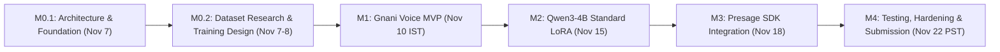

# BreatheFlow AI — Engineering Roadmap

## 1. Project Context & Execution Strategy

**BreatheFlow AI** is a voice-first, adaptive breathing companion targeting two consecutive challenge deadlines while accommodating university end-semester examination commitments:

1. **Gnani AI Great Indian AI Internship Challenge** — Deadline: **November 10, 2026, 11:59 PM IST** (~3 days remaining)
2. **Presage SmartSpectra SDK Challenge** — Deadline: **November 22, 2026, 11:59 PM PST** (~15 days remaining)

### Pragmatic Phasing Strategy
To guarantee delivery without risking academic conflict or missing the early Gnani deadline:
- **Phase 1 (Now – Nov 10)**: Focus strictly on a working Gnani voice MVP (Prisma STT + Qwen base with structured prompting + Timbre TTS + Deterministic Breathing Controller). Fine-tuning is **decoupled** from this milestone so the Gnani MVP remains unblocked.
- **Phase 2 (Nov 11 – Nov 15)**: Implement Hugging Face PEFT/LoRA fine-tuning for Qwen3-4B to deepen conversational style and breathing-cue alignment.
- **Phase 3 (Nov 16 – Nov 22)**: Integrate the Presage SmartSpectra SDK for real-time physiological estimation, complete safety disclosures, record the Presage demo, and publish the DEV post.

---

## 2. Milestone Breakdown & Deliverables

### Milestone M0.1 — Foundation & System Specification (Completed)
- [x] Clone and inspect repository state (`BreatheFlow-AI`).
- [x] Establish `ARCHITECTURE.md` detailing component interactions, flows, and safety boundaries.
- [x] Establish `ROADMAP.md` with realistic timeline, deliverables, and dependency matrix.
- [x] Identify open verification questions for Gnani APIs and Presage SmartSpectra SDK.

---

### Milestone M0.2 — Dataset Research & Training Design (Completed)
> **Primary Goal**: Complete pre-training research, candidate dataset auditing, training schema design, and evaluation criteria specification without blocking the initial Gnani MVP.

#### Core Deliverables
- [x] Audit candidate public datasets on Hugging Face (licensing, content modality, risks).
- [x] Establish strict non-medical safety and non-diagnostic boundaries for data modeling.
- [x] Design conversational SFT schema with dual output (voice response + deterministic JSON controller payload).
- [x] Formulate train/val/test splitting strategy and curated seed generation pipeline.
- [x] Specify quantitative and qualitative evaluation criteria in [`docs/dataset-research.md`](file:///C:/Users/Aadesh/.gemini/antigravity/scratch/BreatheFlow-AI/docs/dataset-research.md).
- [x] Confirm model architecture decisions: Qwen3-4B base (untouched), Standard LoRA (not QLoRA), Hugging Face Transformers + PEFT, Cloud GPU environment, separate adapter persistence.

---

### Milestone M1 — Gnani Voice MVP (Deadline: Nov 10, 2026, 11:59 PM IST)
> **Primary Goal**: Complete, verify, and submit the Gnani AI Great Indian AI Internship Challenge.
> **Note**: This milestone is **strictly decoupled** from model fine-tuning; it uses zero-shot / few-shot prompt-engineered base Qwen3-4B to ensure reliable completion before the deadline.

#### Core Deliverables
- **Genuine Gnani Integration**:
  - Gnani Prisma v2.5 Speech-to-Text (STT) pipeline (audio capture to text transcription).
  - Gnani Timbre v2.5 Text-to-Speech (TTS) pipeline (synthesizing spoken pacing cues and conversational responses).
- **Conversational Brain (Baseline)**:
  - Qwen3-4B zero-shot / few-shot prompt-engineered conversational handler.
  - Session intent parser (identifying user state, selecting breathing patterns like Box Breathing, 4-7-8, Coherent Breathing).
- **Deterministic Breathing Controller (Core Engine)**:
  - Precision interval timer for Inhale / Hold / Exhale cycles independent of model generation latency.
  - Audio/Visual pacing synchronizer.

#### M1 Implementation Sequence Checklist
- [x] **M1.0 — API Research & Specification**: Gnani Prisma v2.5 REST, Timbre v2.5 REST, and local Ollama `qwen3:4b` verified and documented in [`docs/gnani-api-notes.md`](file:///C:/Users/Aadesh/.gemini/antigravity/scratch/BreatheFlow-AI/docs/gnani-api-notes.md).
- [x] **M1.1 — Core Engine Scaffold & Controller Contract**:
  - Typed environment configuration (`breatheflow/config.py`).
  - Provider abstract base classes (`breatheflow/providers/base.py`).
  - Deterministic breathing session controller & protocol dataclasses (`breatheflow/core/controller.py`).
  - Unit tests verifying deterministic phase transitions and pause safety (`breatheflow/tests/test_controller.py`).
- [x] **M1.2 — Provider Adapters (Isolated & Testable)**:
  - Gnani Prisma v2.5 REST STT adapter (`breatheflow/providers/gnani_stt.py`).
  - Gnani Timbre v2.5 REST TTS adapter (`breatheflow/providers/gnani_tts.py`).
  - Local Ollama Qwen3-4B prompt-only adapter (`breatheflow/providers/ollama_brain.py`).
  - Unit test suite with mocked HTTP responses (`tests/test_gnani_adapters.py` and `tests/test_ollama_brain.py`).
- [ ] **M1.3 — Dialogue & Session Orchestrator**:
  - Turn coordinator routing STT transcript $\rightarrow$ Ollama Brain $\rightarrow$ Timbre TTS speech $\rightarrow$ Controller initiation (`breatheflow/core/orchestrator.py`).
  - CLI / runner script for interactive terminal voice session testing.
- [ ] **M1.4 — Submission Package & Delivery (Deadline: Nov 10, 11:59 PM IST)**:
  - Public demo video recording showing genuine Gnani STT & TTS integration with spoken conversation.
  - Documentation disclosure of Gnani APIs and architecture.
  - Public LinkedIn & X (Twitter) posts with required hashtags.
  - Git release tagged `v0.1.0-gnani-mvp`.

---

### Milestone M2 — Qwen3-4B Standard LoRA Fine-Tuning (Target: Nov 15, 2026)
> **Primary Goal**: Specialize Qwen3-4B for empathetic, voice-first mindfulness dialogues and real-time breathing protocol selection using the design from M0.2.

#### Core Deliverables
- **Dataset Assembly (`BreatheFlow-Core-SFT`)**:
  - Curate ~1,000 multi-turn episodes following the schema in `docs/dataset-research.md`.
  - 80/10/10 Train/Validation/Test split with verified non-medical compliance and brevity constraints.
- **Standard LoRA Training Pipeline**:
  - Hugging Face `transformers` + `peft` with **Standard LoRA** (`r=16`, `lora_alpha=32`, full precision base model weights untouched).
  - Cloud GPU training run (e.g., NVIDIA A10G / A100).
  - Fine-tuned adapter saved and versioned independently of base model.
- **Model Evaluation & Integration**:
  - Validation loss convergence and automated JSON syntax adherence check ($\ge 99\%$).
  - Adversarial safety evaluation (100% rejection of diagnostic queries).
  - Adapter loading integration in BreatheFlow session orchestrator.

---

### Milestone M3 — Presage SmartSpectra SDK Integration (Target: Nov 18, 2026)
> **Primary Goal**: Enable live physiological signal acquisition and adaptive session modulation.

#### Core Deliverables
- **SmartSpectra SDK Integration**:
  - Native / Web SDK binding to capture camera frames and stream physiological metrics (e.g., estimated respiration rate or heart rate).
  - Explicit user consent gate and camera authorization UI.
- **Adaptive Guidance Logic**:
  - Inputting physiological estimates into session state without diagnostic claims.
  - Adapting breathing target frequencies (e.g., gently easing a fast breathing pace toward 6 breaths/min).
- **Privacy & Safety Implementation**:
  - Ephemeral processing mode: signals used in-memory for session guidance, zero persistent biometric storage without explicit opt-in.
  - Prominent non-medical disclaimer banner and voice announcement.

---

### Milestone M4 — Testing, Hardening & Presage Challenge Submission (Deadline: Nov 22, 2026, 11:59 PM PST)
> **Primary Goal**: Finalize testing, record Presage demo, write DEV submission, and close the challenge.

#### Core Deliverables
- **End-to-End System Testing**:
  - Latency validation: voice input -> transcription -> conversational turn -> speech output.
  - Signal resilience: handling lost camera frames, noisy audio, or network disconnects gracefully.
- **Presage Challenge Submission Package**:
  - [ ] Comprehensive setup and installation guide in `README.md`.
  - [ ] Transparent consent, privacy, and data-handling disclosure.
  - [ ] Public demonstration video exhibiting live SmartSpectra SDK physiological signal extraction modulating breathing guidance.
  - [ ] Official DEV submission post formatted per challenge requirements.
  - [ ] Final release tagged `v1.0.0-presage-release`.

---

## 3. Challenge Requirements: Mandatory vs. Optional

| Feature / Deliverable | Gnani Challenge (Nov 10) | Presage Challenge (Nov 22) | Classification |
|---|---|---|---|
| **Gnani Prisma v2.5 STT Integration** | **Mandatory** | Optional | Challenge Requirement |
| **Gnani Timbre v2.5 TTS Integration** | **Mandatory** | Optional | Challenge Requirement |
| **Public Demo Video (Gnani)** | **Mandatory** | Optional | Challenge Requirement |
| **LinkedIn / X Public Posts** | **Mandatory** | Optional | Challenge Requirement |
| **Deterministic Breathing Engine** | **Core Product** | **Core Product** | Core Feature |
| **Qwen3-4B Prompted Interaction** | **Mandatory (MVP)** | Base requirement | Core Feature |
| **Qwen3-4B LoRA Fine-Tuning** | *Deferred (post-MVP)* | Recommended | Enhancement |
| **SmartSpectra SDK Integration** | Out of scope | **Mandatory** | Challenge Requirement |
| **Live Physiological Signal Use** | Out of scope | **Mandatory** (>=1 signal) | Challenge Requirement |
| **Consent & Data-Handling Disclosure** | Recommended | **Mandatory** | Safety & Compliance |
| **DEV Submission Post** | N/A | **Mandatory** | Challenge Requirement |
| **Wearable / BLE Sensor Support** | Out of scope | Out of scope | Post-Challenge Backlog |
| **User Account Cloud Sync** | Out of scope | Out of scope | Post-Challenge Backlog |

---

## 4. Dependencies, Risks & Mitigations

| Risk | Impact | Likelihood | Mitigation Strategy |
|---|---|---|---|
| **End-semester exam timetable conflicts** | High | High | Strict timeboxing. Milestone M1 delivers Gnani MVP by Nov 10 using prompted Qwen3-4B, avoiding complex fine-tuning until exams permit. |
| **Gnani API credentials / latency** | High | Medium | Verify Gnani API access and credentials immediately in M0.2; implement graceful fallback/mock audio mode for local development. |
| **Presage SmartSpectra SDK platform constraints** | High | Medium | Confirm SDK runtime targets (Python / C++ / WebAssembly / iOS / Android) before architecting the client boundary. |
| **GPU resource availability for Standard LoRA** | Medium | Low | Confirmed dedicated Cloud GPU environment (e.g. A10G / A100); Standard LoRA fine-tunes only adapter weights while keeping base Qwen3-4B frozen. |
| **Breathing timing drift from LLM latency** | High | Low | LLM is **never** in the timing loop. Breathing pacing is strictly handled by the deterministic interval controller. |
| **Regulatory / Medical claims violation** | Critical | Low | System explicitly states: "BreatheFlow AI is a non-clinical wellness companion and does not diagnose, treat, or detect medical conditions." |

---

## 5. Open Technical Questions Requiring Verification

1. **Gnani API Specifications**:
   - What are the exact protocol endpoints and authentication headers for Gnani Prisma v2.5 (WebSocket vs. REST multipart) and Timbre v2.5?
   - What audio encodings (PCM 16-bit, WAV, Sample Rate 8kHz/16kHz) are accepted/returned?
2. **Presage SmartSpectra SDK Runtime**:
   - What target platforms and languages does the official SDK support (e.g., Python wheels, C++ libraries, JavaScript/Wasm npm package)?
   - What exact signal outputs are provided (e.g., raw photoplethysmography waveform, instantaneous breathing rate in BPM, pulse)?
3. **Qwen3-4B Deployment**:
   - Will Qwen3-4B run locally via `vLLM` / `llama.cpp` or via an inference endpoint (e.g., Hugging Face Inference Endpoints / Ollama) to meet real-time voice response latency requirements?
