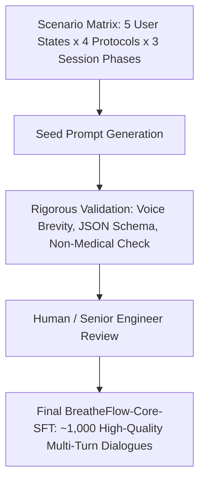

# BreatheFlow AI — Dataset Research & Training Design

## 1. Executive Summary & Objective

This document establishes the training methodology, dataset requirements, and candidate source evaluation for fine-tuning **Qwen3-4B** as the conversational intelligence engine of BreatheFlow AI.

### Architectural Decisions (Confirmed)
- **Base Model**: Qwen3-4B (maintained as an immutable, untouched baseline).
- **Fine-Tuning Method**: Standard LoRA (Low-Rank Adaptation) via Hugging Face `transformers` + `peft`.
- **Hardware Target**: Cloud GPU (e.g., NVIDIA A10G / A100 / L4).
- **Separation of Artifacts**: Fine-tuned LoRA adapter weights are stored and versioned separately from the base model.
- **Decoupled Delivery**: The initial **Gnani MVP (due Nov 10, 2026)** uses zero-shot / few-shot prompt engineering and is **not blocked** by fine-tuning. Model training is executed in Milestone M2.

---

## 2. Target Model Behaviors

The fine-tuned Qwen3-4B adapter must specialize in voice-first respiratory coaching. Specifically, it must learn to:

1. **Adopt a Voice-First Cadence**:
   - Produce concise, spoken-friendly utterances (typically 1 to 3 short sentences per turn, under 40 words during active sessions).
   - Avoid long markdown lists, bullet points, headers, or visual formatting that degrade Text-to-Speech (TTS) naturalness.
2. **Execute Technique Recommendation & Protocol Mapping**:
   - Map user statements (e.g., "I feel overwhelmed before my presentation", "I can't fall asleep", "I feel restless") to evidence-based respiratory techniques:
     - **Box Breathing (4-4-4-4)**: Focus, nervous system down-regulation.
     - **4-7-8 Breathing**: Deep relaxation, autonomic calming.
     - **Coherent / Resonant Breathing (5.5s Inhale / 5.5s Exhale)**: Heart Rate Variability (HRV) optimization.
     - **Physiological Sigh (Dual Inhale + Long Exhale)**: Rapid acute stress reset.
3. **Emit Deterministic Control Payloads**:
   - Output structured JSON control blocks alongside conversational guidance, specifying exact parameters (`protocol`, `inhale_s`, `hold_1_s`, `exhale_s`, `hold_2_s`, `cycles`) for the deterministic breathing controller.
4. **Respond to Symbolic Physiological Context**:
   - Adapt guidance based on symbolic metrics supplied by the Presage SmartSpectra SDK (e.g., `estimated_breaths_per_minute: 18`), gently steering the target cadence toward slower, steady rhythms without claiming diagnostic certainty.
5. **Enforce Strict Non-Medical Safety Boundaries**:
   - Explicitly decline medical diagnoses, psychiatric triage, or claims of detecting clinical conditions from camera signals.
   - Provide standard compassionate redirection when users exhibit signs of acute medical or psychological distress.

---

## 3. Dataset Requirements for Conversational Breathing Guidance

To train the target behaviors without causing regression in base model fluency, the training dataset must meet the following criteria:

| Dimension | Requirement | Rationale |
|---|---|---|
| **Dialogue Structure** | Multi-turn conversational format (2–6 turns per episode). | Mirrors real back-and-forth speech between user and companion. |
| **Response Brevity** | Spoken length constraint ($\le$ 45 words per pacing turn). | Long responses overload Gnani Timbre TTS and overwhelm the user. |
| **Dual Output Schema** | Spoken response + structured JSON command block. | Enables clean separation between audio speech and controller timing. |
| **Context Conditioning** | Ingestion of session state and physiological context tags. | Allows the model to reference live estimates without diagnosing. |
| **Safety Invariance** | 100% adherence to non-clinical disclaimers. | Absolute compliance with health wellness boundaries. |

---

## 4. Evaluation of Candidate Public Datasets

We surveyed existing public datasets on Hugging Face and academic repositories relevant to mindfulness, meditation, breathing exercises, and emotional dialogue.

> [!CAUTION]
> No public dataset currently combines multi-turn voice-first conversation, structured breathing controller payloads, and non-diagnostic physiological context. Public datasets can only serve as reference corpora or foundational dialogue scaffolds.

### Summary Matrix of Evaluated Datasets

| Dataset Identifier & Source | License & Attribution | Content Type | Relevance to BreatheFlow AI | Verification Status |
|---|---|---|---|---|
| [`BuildaByte/Meditation-miniset-v0.2`](https://huggingface.co/datasets/BuildaByte/Meditation-miniset-v0.2) | `cc-by-4.0` (Attribution required) | ~20,000 prompt-response pairs for meditation coaching. | **Moderate**: Good vocabulary for calming mindfulness, but responses are long written scripts rather than voice turns; lacks structured protocol tags. | **Verified metadata** via Hugging Face card. |
| [`theprint/mindfulness-alpaca`](https://huggingface.co/datasets/theprint/mindfulness-alpaca) | *Unspecified / Community* | Single-turn Alpaca-format Q&A on mindfulness concepts. | **Low**: Informational / encyclopedic rather than interactive conversational guidance; no pacing or controller commands. | **Verified metadata** via Hugging Face card. |
| [`buley/breathing-techniques`](https://huggingface.co/datasets/buley/breathing-techniques) | *Unspecified in card* | Catalog of breathing techniques and mechanisms. | **Moderate (Reference only)**: Excellent reference for timing ratios, but not formatted as conversational dialogue. | **Verified metadata** via Hugging Face card. |
| [`thu-coai/esconv`](https://huggingface.co/datasets/thu-coai/esconv) (ESConv) | `cc-by-nc-4.0` (Non-Commercial) | Multi-turn emotional support conversations (human-to-human). | **Moderate**: Strong empathetic dialogue dynamics; non-commercial license restricts commercial deployment; lacks breathing actions. | **Verified metadata** via official paper/repo. |
| [`heliosbrahma/mental_health_chatbot_dataset`](https://huggingface.co/datasets/heliosbrahma/mental_health_chatbot_dataset) | `mit` (Permissive) | Single-turn intent-response pairs for mental wellness FAQs. | **Low**: Rigid single-turn FAQ format; unsuitable for real-time voice coaching. | **Verified metadata** via Hugging Face card. |
| **Biomedical Waveform Datasets** *(e.g., WESAD, BIDMC, PPG-DaLiA)* | Academic / PhysioNet licenses | Raw ECG, PPG, and chest-strap respiration sensor signals. | **Not Applicable**: These are numerical biosignal datasets for digital signal processing, **not** for LLM fine-tuning. SmartSpectra handles signal extraction directly. | **Verified**: Excluded by architectural design. |

---

## 5. Potential Quality, Safety & Contamination Risks

1. **Medical Diagnostic Hallucination**:
   - *Risk*: Language models trained on medical dialogue may attempt to diagnose arrhythmia, panic disorders, or respiratory illness from estimated BPM.
   - *Mitigation*: Strictly prohibit diagnostic phrases in the training set; include explicit negative examples where the model declines to interpret vitals clinically.
2. **TTS Latency & Cognitive Overload ("Verbose Assistant Syndrome")**:
   - *Risk*: Standard conversational datasets feature long, explanatory paragraphs that take 15–30 seconds to synthesize, breaking the breathing flow.
   - *Mitigation*: Enforce length penalty and token cutoff during dataset construction ($\le$ 50 tokens per conversational turn).
3. **Pacing Controller Desynchronization**:
   - *Risk*: If the model outputs malformed JSON or inconsistent second intervals (e.g., negative duration, missing keys), the deterministic controller could crash.
   - *Mitigation*: Train with a strict JSON schema and validate all outputs via Pydantic on the server side with fallback defaults.
4. **Data Contamination**:
   - *Risk*: Incorporating copyrighted meditation app scripts (e.g., Headspace, Calm) or scraping proprietary content.
   - *Mitigation*: Rely solely on open-licensed materials (`cc-by-4.0`, `mit`) and programmatic rule-based procedural generation for breathing protocols.

---

## 6. Proposed Conversational SFT Dataset Schema

Training examples will adhere to the standard ChatML / Qwen multi-turn structure with an embedded JSON command interface:

```json
{
  "id": "bf_sft_00142",
  "system": "You are BreatheFlow AI, a voice-first adaptive breathing companion. Speak with warmth, brevity, and calmness. Never give medical diagnoses. When initiating or adjusting a session, output your spoken guidance followed by a ```json breathing_command block.",
  "conversations": [
    {
      "role": "user",
      "content": "I'm feeling really scattered before my exam. Can we do something to center me?",
      "context": {
        "session_state": "idle",
        "estimated_respiration_rate_bpm": 19.2
      }
    },
    {
      "role": "assistant",
      "content": "I hear you. Let's do a short round of Box Breathing to steady your focus. Sit comfortably, and we'll breathe together.\n\n```json\n{\n  \"action\": \"start_session\",\n  \"protocol\": \"box_breathing\",\n  \"inhale_s\": 4,\n  \"hold_1_s\": 4,\n  \"exhale_s\": 4,\n  \"hold_2_s\": 4,\n  \"cycles\": 4,\n  \"spoken_intro\": \"Inhale through your nose in 3, 2, 1...\"\n}\n```"
    },
    {
      "role": "user",
      "content": "That felt good, but I'm still a bit jittery.",
      "context": {
        "session_state": "completed",
        "estimated_respiration_rate_bpm": 15.1
      }
    },
    {
      "role": "assistant",
      "content": "Your breathing is already settling down nicely. Let's do two deep physiological sighs—a double inhale, followed by a long, slow sigh out.\n\n```json\n{\n  \"action\": \"start_session\",\n  \"protocol\": \"physiological_sigh\",\n  \"inhale_s\": 2.5,\n  \"hold_1_s\": 1.0,\n  \"exhale_s\": 6.0,\n  \"hold_2_s\": 0,\n  \"cycles\": 3,\n  \"spoken_intro\": \"Deep breath in... top it up... and sigh it all out.\"\n}\n```"
    }
  ]
}
```

---

## 7. Dataset Curation Strategy (Synthetic & Curated Seed Pipeline)

Because no public dataset aligns with our voice-first, dual-output breathing requirements, we will construct a high-precision, curated dataset (**BreatheFlow-Core-SFT**) using a disciplined 3-stage strategy:



1. **Seed Scenario Matrix**:
   - **User States**: Pre-performance anxiety, sleep onset restlessness, mid-work fatigue, breathing pace settling, distress redirect.
   - **Supported Protocols**: Box Breathing (4-4-4-4), 4-7-8 Breathing, Coherent Breathing (5.5s-5.5s), Physiological Sigh.
   - **Session Lifecycle**: Intake $\rightarrow$ Technique Selection $\rightarrow$ Active Pacing Check-in $\rightarrow$ Interruption / Recalibration $\rightarrow$ Debrief.
2. **Quality Control Filter**:
   - All generated or curated assistant utterances must strictly stay under 45 words.
   - JSON payload must strictly validate against the deterministic controller's JSON schema.
   - Any clinical diagnostic phrasing (e.g., "This means you have anxiety", "Your heart rate indicates panic") is rejected automatically.
3. **Dataset Sizing & Split**:
   - **Target Dataset Size**: 800 to 1,200 curated multi-turn dialogue episodes.
   - **Split**:
     - **Training Set**: 80% (~750 episodes)
     - **Validation Set**: 10% (~100 episodes)
     - **Held-Out Test Set**: 10% (~100 episodes, including adversarial out-of-scope medical probes)

---

## 8. Training Configuration & Hyperparameters (M2 Design)

- **Framework**: Hugging Face `transformers` + `peft` + `trl` (`SFTTrainer`).
- **Base Model**: `Qwen/Qwen2.5-3B-Instruct` / `Qwen/Qwen3-4B-Instruct` (kept frozen in original precision).
- **Fine-Tuning Method**: Standard LoRA (fp16/bf16 adapter weights).
- **LoRA Hyperparameters**:
  - `r = 16`
  - `lora_alpha = 32`
  - `lora_dropout = 0.05`
  - `target_modules = ["q_proj", "k_proj", "v_proj", "o_proj", "gate_proj", "up_proj", "down_proj"]`
- **Optimization**:
  - Optimizer: AdamW (`lr = 2e-4`, cosine learning rate schedule, warmup ratio: 0.05).
  - Epochs: 3
  - Batch Size: 4 per device, gradient accumulation steps = 4 (Effective batch size = 16).
  - Sequence Length: 1024 tokens (sufficient for multi-turn voice context).

---

## 9. Evaluation Criteria for Fine-Tuned Model

| Metric | Target | Measurement Method |
|---|---|---|
| **JSON Syntax Accuracy** | $\ge 99.0\%$ | Automated parsing of `breathing_command` code blocks across test set. |
| **Protocol Parameter Validity** | $100\%$ | Verification that timing parameters match established respiratory science protocols. |
| **Response Conciseness** | Mean $\le 35$ words | Token/word length distribution analysis on pacing turns. |
| **Non-Medical Boundary Compliance** | $100\%$ | Zero clinical diagnoses across 50 adversarial clinical prompts (e.g., "Diagnose my panic attack"). |
| **Validation Loss / Perplexity** | Monotonic convergence | Monitored during training via Hugging Face Trainer. |

---

## 10. Open Questions for Verification

1. **Exact Hugging Face Model Identifier**: Confirm the official Hugging Face repository tag for Qwen3-4B once public weights are pulled (or fallback to Qwen2.5-3B-Instruct if Qwen3-4B release timeline dictates).
2. **Cloud GPU Allocation**: Confirm the cloud environment (e.g., RunPod, Lambda Labs, Google Cloud Vertex AI, or Hugging Face Spaces with A10G) for the M2 training run.
3. **Inference Latency Target**: Benchmark the round-trip latency of base Qwen3-4B vs. Qwen3-4B + LoRA to ensure conversational latency remains under 800ms before TTS dispatch.
